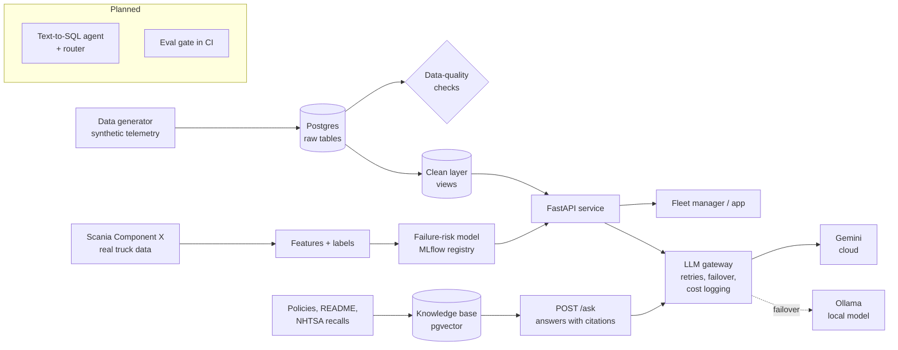

# FleetPilot


**An LLMOps / MLOps platform for fleet telemetry.**
Fleet managers ask questions about their vehicles in plain language ("Which trucks had engine warnings last week?"), and FleetPilot answers from live telemetry data and maintenance documents. Around the chatbot sits the production platform: data-quality gates, an API, model tracking, an LLM gateway with failover and cost logging, automated evaluation, CI/CD and monitoring.

> Status: **work in progress**. Data layer, data-quality checks, API, a predictive-maintenance model trained on **real Scania truck data** (tracked in MLflow), an **LLM gateway** with failover and cost logging, and **CI** are done. See the [roadmap](#roadmap).

---

## Architecture (current + planned)



## Data model

Five tables in PostgreSQL ([`db/schema.sql`](db/schema.sql)):

| Table | One row = | Links to |
|---|---|---|
| `vehicles` | one truck / van / car | — |
| `drivers` | one driver | — |
| `trips` | one journey | vehicles, drivers |
| `sensor_readings` | one sensor reading per minute while driving (+ parked heartbeats) | vehicles, trips |
| `warnings` | one warning event (e.g. engine overheat) | vehicles, trips |

Design choices:
- **NULL only where a value honestly doesn't exist** (trip still running → `ended_at` NULL; electric truck → `fuel_used_liters` NULL; parked → `trip_id` NULL; not fixed yet → `resolved_at` NULL).
- **Each fact stored once.** The vehicle model lives only in `vehicles`; other tables reach it with a JOIN.
- **Raw vs clean layers.** Raw tables keep everything the sensors send. Views in [`db/clean_views.sql`](db/clean_views.sql) remove duplicates, turn impossible values into NULL and normalise text. The API only reads the clean layer.

## Data quality

The synthetic data deliberately contains realistic sensor problems. [`scripts/check_data_quality.py`](scripts/check_data_quality.py) runs SQL checks and exits with code 1 if any fail, so it can block a pipeline.

| Check | Problem type | Bad rows found |
|---|---|---|
| duplicate sensor readings (same vehicle + minute) | duplicates | 462 |
| missing speed while driving | missing values | 925 |
| negative / impossible speed | impossible values | 40 |
| engine temperature out of range (999 °C) | impossible values | 40 |
| invalid fuel type (`Diesel`, `diesel `) | messy text | 8 |
| trips ending before they start | impossible values | 0 |
| trips pointing to a missing vehicle | broken pointers | 0 |

Tests confirm the checker finds exactly the planted problems, and that the clean layer removes them.

## Predictive maintenance (real data: Scania trucks)

**Question:** will a truck's Component X fail within the next 48 time steps?

**Data:** the public [SCANIA Component X dataset](https://doi.org/10.5878/bnh5-ka77): operational sensor readouts, repair records and specifications from about 33,000 real heavy trucks (anonymised signals). License: CC BY 4.0.

**Pipeline** ([`ml/`](ml/)):
1. **Features** ([`ml/features.py`](ml/features.py)): sensor counters at each readout, their **change since the previous readout** (how hard the truck is working now), truck specifications, and the truck's age in time steps.
2. **Labels:** a training readout is positive if the truck was repaired within the next 48 steps. Several random readouts per truck are used, not just the last one.
3. **No leakage:** train, validation and test are **different trucks** (Scania's own split). Validation and test are scored on each truck's last readout, like scoring a fleet today.
4. **Model** ([`ml/train.py`](ml/train.py)): gradient-boosted trees (scikit-learn `HistGradientBoostingClassifier`), class weights for the rare failures, compared against a **baseline** that always predicts the average failure rate.
5. **Metrics:** PR-AUC (main metric, because failures are rare), ROC-AUC, precision and recall at a threshold tuned on validation.
6. **MLflow:** every run logs parameters, metrics and the model; each model is registered as a new version. **Promotion gate:** a version becomes `champion` only if its validation PR-AUC beats the current champion.
7. **Serving:** the API loads the `champion` model from the registry.

**Results** (model version 1, trucks never seen in training):

| | Baseline (predicts average rate) | Model, validation | Model, test |
|---|---|---|---|
| PR-AUC | 0.027 | **0.070** | **0.077** |
| ROC-AUC | 0.500 | **0.734** | **0.735** |
| Recall at tuned threshold | 0.00 | 0.30 | 0.54 |

Only about 2.7% of trucks fail within the window, so PR-AUC is the honest metric: the model is about **2.7× better than the baseline**, and validation and test scores agree (no overfitting). Accuracy is not reported: a model that always says "no failure" would be 97% accurate and useless.

Full numbers: `data/scania/processed/last_training_report.json` after training, or the MLflow UI.

## LLM gateway

One front door to several LLM providers ([`app/llm/`](app/llm/)). Every request:

1. **Budget guard**: refuses new calls once today's spending reaches `LLM_DAILY_BUDGET_USD` (HTTP 429).
2. **Providers in order** (`LLM_PROVIDER_ORDER`, default Gemini → Ollama).
3. **Timeout** on every call.
4. **Retries with exponential backoff** only for errors that can recover (timeout, HTTP 429, 5xx); a bad key or bad request moves on immediately.
5. **Failover** to the next provider when one gives up.
6. **Circuit breaker**: after 3 failures in a row a provider is skipped for 60 s instead of being hammered.
7. **Logging** of every attempt to the `llm_calls` table: provider, model, input/output tokens, latency, cost, status, error. `GET /llm/usage` summarises it.

| Provider | Runs | Key | Role |
|---|---|---|---|
| Google Gemini | cloud | `GEMINI_API_KEY` in `.env` | main |
| Ollama (`llama3.2`) | locally | none | backup, free, works offline |

API keys live only in `.env` (git-ignored) and are sent in a header, never in a URL or a log. The gateway is tested with **fake providers** that simulate timeouts, rate limits and bad keys, so the tests need no key and no internet.

## Knowledge base for RAG

The chatbot will answer from **our own documents** instead of guessing. Without them, both LLMs hallucinated what FleetPilot is ("a GPS system", "flight-planning software", "autonomous-driving software").

| Source | What | Where |
|---|---|---|
| Maintenance policies | 6 short **sample** policies for a fictional fleet company (brakes, tires, overheating, EV battery, warning codes, service schedule) | [`docs/policies/`](docs/policies/) |
| FleetPilot README | what this project is | `README.md` |
| NHTSA recalls | real US safety recall notices for the US versions of our fleet (Isuzu NPR, Hino, Fuso, Prius, bZ4X, NV200, Transit...) | public NHTSA API → `data/docs/` (git-ignored) |

Pipeline ([`rag/`](rag/)):
1. **Chunking:** split each document into pieces of up to 800 characters with 150 characters of overlap, keeping paragraphs together.
2. **Embeddings:** turn each chunk into a 768-number vector with `nomic-embed-text`, running **locally in Ollama** (free, no key, documents never leave the machine).
3. **Storage:** `documents` + `doc_chunks` tables in Postgres with **pgvector** and an HNSW index for fast cosine-similarity search.
4. **Search:** embed the question and return the closest chunks with their source.

Re-running the ingest replaces documents instead of duplicating them. Tests use a fake embedder and roll back their transaction, so they need no model and never touch the real knowledge base.

## RAG answers (`POST /ask`)

[`rag/answer.py`](rag/answer.py) runs an "open-book exam" for every question:

1. **Search** the knowledge base for the 5 most similar chunks.
2. **Relevance check:** if even the best chunk is below `RAG_MIN_SIMILARITY`, answer *"I don't know"* **without calling the LLM** (no guessing, no cost).
3. **Prompt** the LLM with the numbered sources and strict rules: use only these sources, cite them as [1], [2], say "I don't know" otherwise.
4. **Answer** through the LLM gateway (retries, failover and cost logging included).
5. **Citation check:** keep only source numbers that really exist; `answered_from_sources` is false when nothing valid was cited.

The response contains the answer, the cited source numbers, every source shown to the model (title, link, similarity), tokens, cost and the time spent on search vs. the LLM.

## API

| Endpoint | Description |
|---|---|
| `GET /health` | API + database status (`503` if the database is unreachable) |
| `GET /vehicles` | list vehicles; filters: `depot`, `status`, `fuel_type`; paging: `limit` (1–500), `offset` |
| `GET /vehicles/{id}` | one vehicle (`404` if unknown) |
| `GET /vehicles/{id}/warnings` | warnings for a vehicle, `open_only=true` for unresolved |
| `GET /scania/vehicles` | Scania trucks that can be scored |
| `GET /scania/vehicles/{id}/failure-risk` | failure probability within 48 steps, `at_risk` flag, model version (`503` if no model trained yet) |
| `POST /llm/chat` | ask the LLM through the gateway; returns answer, provider, tokens, cost, latency, attempts (`503` all providers failed, `429` budget reached) |
| `GET /llm/usage` | calls, errors, average latency, tokens and cost per provider in the last 24 h |
| `POST /ask` | answer a question from FleetPilot's documents with citations; *"I don't know"* when the documents don't cover it |

All queries use parameter binding (no SQL injection). Interactive docs at `http://localhost:8000/docs`.

## Quickstart (macOS)

Requirements: Python 3.9+, PostgreSQL ([Postgres.app](https://postgresapp.com/)), a database called `fleetpilot`.

```bash
python3 -m venv .venv
source .venv/bin/activate
pip install -r requirements.txt
cp .env.example .env                    # edit DATABASE_URL if needed

python scripts/generate_data.py         # 1. create synthetic data (seed 42, reproducible)
python scripts/load_db.py               # 2. create tables, load CSVs, build clean views
python scripts/check_data_quality.py    # 3. data-quality report
pytest                                  # 4. run the tests
uvicorn app.main:app --reload           # 5. start the API → http://localhost:8000/docs
```

LLM gateway (needs a free Gemini key and/or [Ollama](https://ollama.com)):

```bash
ollama pull llama3.2                    # local backup model
# put GEMINI_API_KEY=... in .env (see .env.example)
uvicorn app.main:app --reload           # then try POST /llm/chat at http://localhost:8000/docs
```

Knowledge base (needs Ollama):

```bash
ollama pull nomic-embed-text                        # local embedding model
python scripts/download_nhtsa_recalls.py            # real recall notices -> data/docs/
python -m rag.ingest                                # chunk + embed + store in pgvector
python -m rag.search "how often should brake pads be checked?"
# then try POST /ask at http://localhost:8000/docs
```

Predictive maintenance (needs the Scania download, ~1.5 GB):

```bash
# download all files from https://doi.org/10.5878/bnh5-ka77 and unzip into data/scania/
python -m ml.train                                        # features → train → MLflow → promote
mlflow ui --backend-store-uri sqlite:///mlflow.db         # browse runs → http://localhost:5000
```

Example questions answered in SQL: [`sql/business_queries.sql`](sql/business_queries.sql) (these will become the golden test set for the text-to-SQL chatbot).

## Project structure

```
app/            FastAPI service (config, db connection, schemas, routes, predictions)
app/llm/        LLM gateway: providers, retries, failover, circuit breaker, cost logging
ml/             Scania features, labels, training, MLflow tracking + registry
rag/            knowledge base: chunking, embeddings, ingest, vector search
docs/policies/  sample maintenance policies (fictional company) for RAG
db/             schema, CSV load (psql), clean-layer views
scripts/        data generator, Python loader, data-quality checks
sql/            business questions in SQL
tests/          API, data-quality, ML-feature and LLM-gateway tests (pytest)
.github/        GitHub Actions: fresh Postgres → load data → run all tests on every PR
```

## Roadmap

- [x] PostgreSQL schema for fleet telemetry
- [x] Reproducible synthetic data generator with planted data-quality issues
- [x] Data-quality checks + clean layer
- [x] FastAPI service with tests
- [x] Predictive-maintenance model on real Scania truck data + MLflow tracking, registry and promotion gate
- [x] Failure-risk endpoint serving the champion model
- [ ] Real driving telemetry (Vehicle Energy Dataset) for the chatbot
- [x] LLM gateway: multiple providers, retries, timeouts, failover, circuit breaker, budget guard, token and cost logging
- [x] CI: GitHub Actions runs all tests on every pull request
- [x] Knowledge base: policies + NHTSA recalls, chunked, embedded locally, stored in pgvector
- [x] RAG answers with citations and an "I don't know" guard
- [ ] Text-to-SQL agent + router (documents vs. database)
- [ ] Evaluation: golden Q&A set + LLM-as-judge, run as a quality gate in GitHub Actions
- [ ] Docker + deployment
- [ ] Tracing and cost dashboard, drift monitoring, AWS (Terraform), Kubernetes

## Data and credits

- **Fleet telemetry (Postgres):** synthetic, generated by [`scripts/generate_data.py`](scripts/generate_data.py), with deliberately planted data-quality issues to test the checks.
- **Recalls:** US National Highway Traffic Safety Administration (NHTSA) public recalls API, https://api.nhtsa.gov. Public US government data.
- **Maintenance policies:** written for this demo; fictional company, not manufacturer guidance.
- **Predictive maintenance:** SCANIA Component X dataset by Scania CV AB, published by the Swedish National Data Service, [doi:10.5878/bnh5-ka77](https://doi.org/10.5878/bnh5-ka77), licensed CC BY 4.0. Paper: [arXiv:2401.15199](https://arxiv.org/abs/2401.15199).
- No company-internal data is used. The `data/` folder is git-ignored; datasets are downloaded or generated locally.
